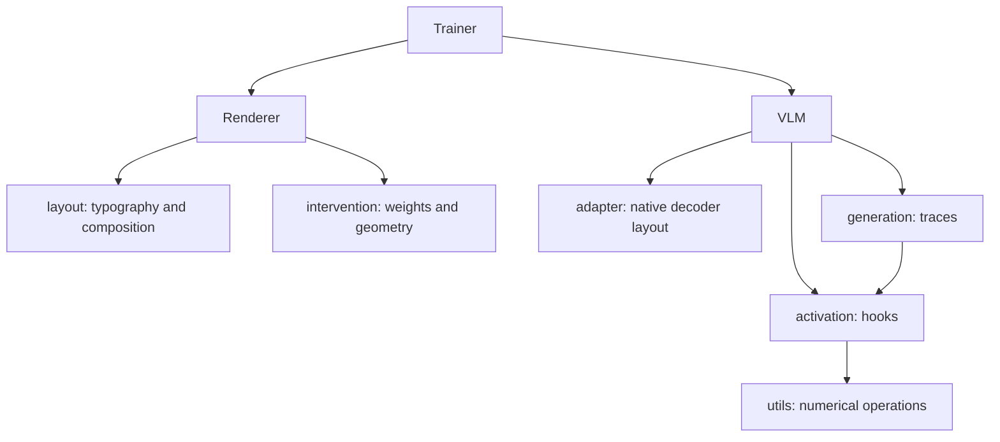

# Architecture

VLMBox supplies shared model operations for controlled VLM experiments: prepare inputs, inspect decoder states, intervene on activations, trace generation, and optimize visual interventions. VLMBox owns model-layout adaptation and decoder-layer semantics. Experiment code owns datasets, messages, losses, token masks, metrics, and reporting.

The public package root exports `VLM`, `Renderer`, and `set_seed`. Optional training lives in `vlmbox.trainer`, numerical helpers in `vlmbox.utils`, and trace result types in `vlmbox.model.generation`. Native model/processor access is an advanced escape hatch. Daily research adapters should use the shared operations; recurring native workarounds indicate a missing shared operation.

## Core objects and package boundaries

| Object | Responsibility | Public import |
|---|---|---|
| `VLM` | Load/wrap the native model and processor; prepare inputs, execute, inspect activations, and trace generation | `from vlmbox import VLM` |
| `Renderer` | Compose visual inputs and own trainable visual intervention parameters using standard PyTorch module operations | `from vlmbox import Renderer` |
| `Trainer` | Coordinate frozen-model optimization of a renderer using the caller's loss function | `from vlmbox.trainer import Trainer` |

`Sample`, `TrainStep`, and `LossFunction` describe the trainer's inputs, results, and loss contract. `ModelAdapter` is the model-layout extension contract. Activation contexts and generation traces support the `VLM` interface; they do not require separate top-level subsystems. `set_seed` and numerical operations are utility functions.

Packages group several related implementations, rather than requiring a directory for every class. `model/` groups the model entry point, native layout adapter, activation operations, and generation traces. `renderer/` groups rendering, typography, and visual parameters. These packages have independent responsibilities and share no model-specific rendering logic. `trainer.py` remains one file because its records, loss contract, and optimization loop form one small component; `utils.py` remains shared utilities. Package `__init__.py` files expose entry points without implementing them.

## Files and their responsibilities

```text
vlmbox/
├── __init__.py
├── model/
│   ├── __init__.py
│   ├── model.py
│   ├── adapter.py
│   ├── activation.py
│   └── generation.py
├── renderer/
│   ├── __init__.py
│   ├── renderer.py
│   ├── layout.py
│   └── intervention.py
├── trainer.py
└── utils.py
```

| File | Responsibility and reason to exist separately |
|---|---|
| `model/model.py` | The `VLM` entry point: checkpoint loading, native input preparation, device transfer, and delegation to research operations |
| `model/adapter.py` | Maps supported native model layouts to zero-based decoder blocks, attention, and MLP; isolates architecture-specific paths |
| `model/activation.py` | Owns hook installation/removal, token selection, capture, and intervention; shared by single-forward capture and generation traces |
| `model/generation.py` | Owns trace data, per-forward alignment, logits, decoding, and finish-reason inference; avoids mixing generation-result adaptation into model loading |
| `trainer.py` | Coordinates frozen-model image optimization and state restoration; rendering remains usable independently |
| `utils.py` | Small shared numerical and reproducibility operations with explicit precision and gradient behavior |
| `renderer/renderer.py` | Public `Renderer`: YAML loading, rendering orchestration, bounded caching, metadata, and intervention weight persistence |
| `renderer/layout.py` | Internal PIL RGB conversion, typography, image/Tensor composition, and layout metadata; has no model or optimizer dependency |
| `renderer/intervention.py` | One `Intervention` module for patch/delta parameters, projection bounds, and host-relative geometry; has no typography or model dependency |
| `__init__.py` files | Define the small public import surfaces; contain no implementation logic |

Each implementation file isolates an operation with its own invariants and validation. The root contains the two domain packages, the trainer, shared utilities, and their exports. Rendering implementation details are grouped by responsibility in the rendering package; only `Renderer` is its supported public interface.

Module names use nouns for components (`model`, `adapter`, `renderer`, `trainer`), domain data/operations (`activation`, `generation`, `layout`, `intervention`), or shared utilities (`utils`). `trainer.py` names the concrete optimizer component; `Trainer` optimizes rendered intervention parameters against a frozen VLM; `Sample` is its input record and `TrainStep` its scalar output record. The callable `LossFunction` protocol defines a single-forward loss contract; `Trainer` accepts it as `loss_function`, while `TrainStep.loss` records the scalar value.

## Rendering dependencies



The former `image_render.py` orchestrator and three root private modules are consolidated into three rendering implementations. RGB conversion joins layout; bounding-box geometry joins interventions. The separate `_image.py` helper module is removed. `ImageRenderer` is renamed to `Renderer` because the rendering package already supplies the image context. Existing YAML and checkpoint formats are retained.

The renderer accepts native-size PIL host images and returns PIL images. Typography, the host-local intervention, and final canvas coordinates remain distinct. Calling `renderer(host, instruction)` returns a differentiable CHW Tensor; `.render(...)` returns PIL. As an `nn.Module`, the renderer supplies standard `.parameters()` and `.to()` operations. Both `Trainer` and custom research loops use this interface and call `.project_()` after updates. Learned weights are stored separately from YAML initialization, with type/geometry/bounds validation and parameter hashes.

## Canonical decoder-layer contract

Every VLMBox layer parameter is a zero-based decoder block index. `0` selects the first block; attention and MLP operations use their containing block's index. Block states are direct module outputs before any separate final model normalization. `capture()` and `generate_trace()` use the same block meaning, including the last block. Embeddings and final-normalized outputs are distinct quantities, not extra decoder indices.

Generation traces use temporary hooks only on selected blocks and disable native hidden-state output. This avoids architecture-specific embedding offsets, native tuple layouts, and last-layer normalization differences. The first trace step equals full-token block capture from the same generation. The backend still owns generation and its cache; VLMBox aligns captured forwards to predicted tokens and rejects unalignable schedules. All hooks are removed on success and failure.

Legacy projects convert old stored layer numbers once at migration boundaries. New project APIs use the library contract directly. See [research adapters and migration](research-adapters.md).

## Model execution and validation

`VLM.from_pretrained()` resolves a ModelScope checkpoint and loads native Transformers objects. `VLM(model, processor, adapter=...)` supports optional custom loading while preserving model state. Both preparation paths share chat-template controls. Differentiable preparation validates Tensor images, uses native CPU image preprocessing without detaching, and transfers prepared inputs to the model device.

`Trainer.fit()` freezes model parameters, renders each batch, applies the caller's scalar loss, updates only intervention parameters, and projects their bounds. Model parameter flags and every submodule's original training mode are restored even on failure.

CPU tests cover numerical behavior, layer semantics before final normalization, capture/trace equivalence, hook cleanup, typography, parameter persistence, and training restoration. GPU tests validate the same operations on cached Qwen2.5-VL, InternVL, and SmolVLM models. Experiment-specific scientific outcomes remain separately evaluated by research code.


## Code boundaries and cleanup

Keep complete, single-use steps near their caller. Extract an ordinary named function only when it represents a reusable operation or a substantial independent algorithm. Shared helpers use domain names such as `layer_indices`, `activation_tensor`, and `anchored_bbox`. The supported API is the documented interface and each module's `__all__`; helper names do not enlarge the package-root exports. There are no underscore-prefixed helper functions or methods, apart from Python's special methods. Private state such as hook stacks and typography caches remains an implementation detail.

Decoder resolution now uses standard attribute traversal rather than a chain of path, candidate, sequence, and component wrappers. Hook ownership uses `ExitStack` so partial installation and model failures always release hooks. Trace capture stays beside generation; shared activation selection and tensor extraction stay in `activation.py`. Patch and local-additive rendering share one parameter implementation and preserve standard PyTorch `forward`/`apply` behavior. Layout metadata describes layout only; intervention provenance is added by the renderer. Weight checkpoint format and YAML schema remain unchanged.

The remaining numerical helpers are used by activation projection or the paired-prompt example, including projection-length and cosine measurements. Public result accessors are retained for callers even when library internals do not use them. Local reference counts alone are not grounds for deleting supported research operations.

## Next refinements

1. **Validate research adapters against real objectives.** LoopPatch's existing adapter tests cover its current use. Next, exercise HijackPatch's actual loss with differentiable preparation and canonical block captures in a small adapter before migrating training scripts. Keep experiment-specific token masks, reference states, and multi-forward losses in the research repository. Add shared operations only for demonstrated duplication across adapters.
2. **Reduce configuration choices.** A future schema can remove fixed `host.preserve_original_size` and `host.color_space` switches because native size and RGB are protocol invariants. Keep the present schema readable until a deliberate migration; avoid aliases and a general configuration framework. Clarify whether `Sample.image_instruction` should be required at construction since the current trainer always requires it.
3. **Profile the preparation boundary.** Measure CPU image conversion, native processor work, host-to-device transfers, and model forward separately on representative research batches. Optimize demonstrated costs while preserving native pixel outputs and gradients. Cache reusable typography, never tensors retaining a previous step's autograd graph.

The model and renderer packages express the current domain boundaries. Split the trainer only if it develops independently useful components. No backend registry, trainer callback framework, or additional facade is justified by the present adapters. The next architectural evidence should come from smaller research adapters and reproducible timing measurements.
