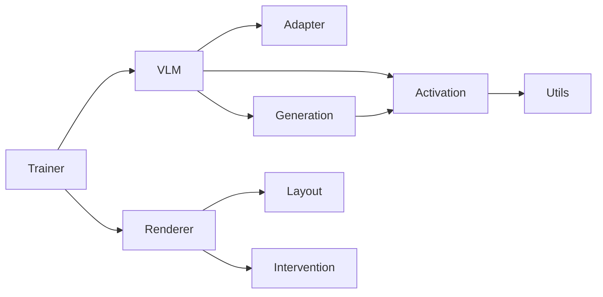

# Architecture

VLMBox has three core objects: `VLM` runs models and decoder operations; `Renderer` owns visual composition and intervention parameters; `Trainer` coordinates frozen-model optimization with a caller-provided loss. Research projects own datasets, messages, losses, token masks, metrics, and reporting.

## Packages

```text
vlmbox/
├── __init__.py
├── model/
│   ├── __init__.py
│   ├── model.py          # VLM: loading, preparation, execution
│   ├── adapter.py        # Native decoder layout → canonical blocks
│   ├── activation.py     # Selection, capture, edits, hook lifetime
│   └── generation.py     # Trace records and token/forward alignment
├── renderer/
│   ├── __init__.py
│   ├── renderer.py       # Renderer: YAML, composition, cache, persistence
│   ├── layout.py         # Typography, image conversion, layout metadata
│   └── intervention.py   # Shared patch/delta parameters and host geometry
├── trainer.py            # Trainer, Sample, TrainStep, LossFunction
└── utils.py              # Numerical operations and reproducibility
```

Packages group related implementations. `model/` and `renderer/` each contain distinct responsibilities; the trainer remains one cohesive file. Export files contain no implementation. The package root exposes only `VLM`, `Renderer`, and `set_seed`; training and extension types use explicit [API imports](api.md).

## Dependencies and contracts



- VLMBox owns zero-based decoder-block indices and direct block states before separate final normalization. Capture and traces share this contract.
- Temporary hooks use `ExitStack` for cleanup on success and failure. Native Transformers owns model execution and generation caches.
- `Renderer` is an `nn.Module`; trainers and custom loops use the same parameters, differentiable forward, and bounded projection. Typography caches are bounded CPU data, independent of autograd graphs.
- `Trainer` owns model freezing/restoration and optimizer steps. `LossFunction` defines one scalar loss after one model forward; project-specific multi-forward objectives own their loops.
- Shared algorithms have ordinary semantic names. Supported interfaces are documented and listed in `__all__`; implementation helpers do not expand root exports.

## Research adapters and migration

Use `VLM` operations for common preparation, capture, steering, and traces. Native `.model`/`.processor` and `.adapter.layer(index)` support experiment-specific operations. Convert legacy one-based layer numbers once at the artifact/configuration boundary. Native hidden-state tuples may include embeddings or final-normalized states; recompute caches when their quantity differs from raw-block traces.

LoopPatch already uses these operations; its visual-token masks and bounded steering remain project code. HijackPatch's standalone adapter needs an explicit runtime and loss/preprocessing regression check before migration.

Current extension imports live under `vlmbox.model.adapter`, `.activation`, and `.generation`. `VLM` remains available from `vlmbox` and `vlmbox.model`. `ImageRenderer` is now `Renderer`; training types live in `vlmbox.trainer`, numerical/reproducibility functions in `vlmbox.utils`. Removed modules have no compatibility aliases. Existing rendering YAML schema 1 and intervention checkpoint format are retained.
